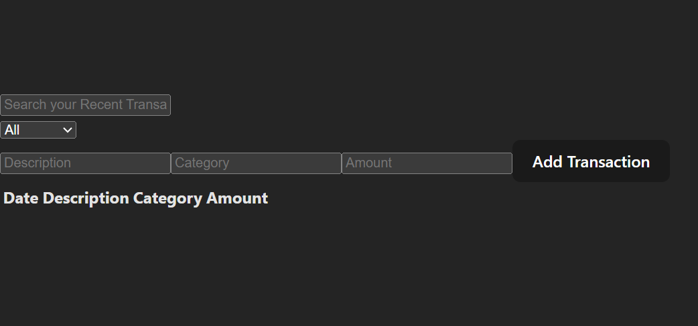

# Banking Transactions App

## Overview
This is a React application that allows users to manage financial transactions.  
Users can view, search, sort, and add transactions. The application connects to a backend API and includes a full test suite using Vitest and React Testing Library.

---

## Features

- View all transactions on page load
- Add new transactions via a form
- Search transactions by description in real time
- Sort transactions by category or amount
- Dynamic UI updates after every action
- Fully tested using Vitest

---





## Tech Stack

- React
- Vite
- Vitest
- React Testing Library
- JSON Server (mock backend API)

---

## Installation

Clone the repository:

```bash
git clone <your-repo-url>
cd react-testing-lab

